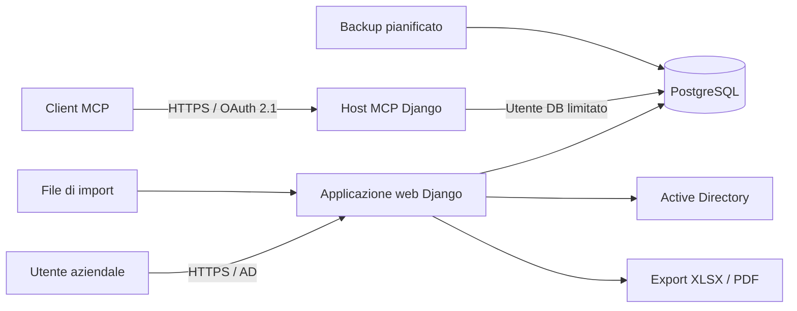

# Architettura del Registro contratti ICTDINN

## Scopo

Questo documento descrive la struttura tecnica dell'applicazione, i confini tra i componenti e le dipendenze principali. I requisiti funzionali e le regole di dominio restano nella [SPEC](SPEC.md); le procedure di produzione sono nel [RUNBOOK](RUNBOOK.md).

## Contesto

Il Registro contratti è un'applicazione Django interna che gestisce il ciclo di vita dei contratti ICTDINN e il processo d'acquisto collegato. L'interfaccia web, i report e il connettore MCP condividono lo stesso dominio applicativo e lo stesso database PostgreSQL.

Il componente MCP è facoltativo e usa una configurazione Django e un utente PostgreSQL distinti. Login, amministrazione e interfaccia ordinaria restano sull'host interno.

## Componenti

| Percorso | Responsabilità |
|---|---|
| `accounts/` | utenti, autenticazione LDAP, ruoli, permessi e account break-glass |
| `contratti/` | modelli e casi d'uso di fabbisogni, contratti, RDA, fatture ed esecuzione |
| `contratti/engine/` | funzioni pure per date, scadenze, importi, budget e previsioni |
| `contratti/importer/` | lettura, normalizzazione e controllo degli import |
| `reports/` | selettori, viste, XLSX e PDF |
| `connettore/` | protocollo MCP, OAuth, serializzazione e strumenti |
| `config/settings/` | impostazioni separate per sviluppo, test, produzione e MCP |
| `deploy/` | immagini, stack Compose, deploy, backup e ripristino |
| `tests/` | test unitari, di integrazione, UI ed end-to-end |

## Regole di dipendenza

1. Il motore in `contratti/engine/` non dipende dall'ORM né da I/O.
2. Gli adapter traducono i modelli Django negli input del motore.
3. Viste web e strumenti MCP riutilizzano gli stessi form, servizi e selettori.
4. Le regole di dominio non devono essere duplicate nei template o nel protocollo MCP.
5. I valori derivati si calcolano; non si persistono salvo le eccezioni definite nella SPEC.
6. Ogni scrittura deve rispettare permessi, storia delle modifiche e assenza di cancellazioni fisiche.
7. Gli import applicano una fase di normalizzazione e producono anomalie verificabili.

## Flussi principali

### Interfaccia web

La richiesta attraversa autenticazione, permessi per ruolo e cluster, form/servizi di dominio e ORM. I template Django e HTMX compongono l'interfaccia senza dipendenze da servizi esterni.

### Import

I file sono letti dalle directory operative, normalizzati, validati e importati in modo idempotente ove previsto. Il comando `--dry-run` deve precedere gli import operativi.

### Report

I selettori producono dati coerenti con il motore. Gli stessi risultati alimentano pagine HTML, export XLSX, PDF e strumenti MCP.

### Connettore MCP

Il client usa OAuth con PKCE. Le letture applicano la visibilità dell'utente; le scritture seguono due passi: anteprima senza persistenza e conferma esplicita. L'utente PostgreSQL del container MCP ha privilegi ridotti.

## Deployment

L'immagine applicativa contiene codice, dipendenze e file statici. In produzione:

- Gunicorn serve l'applicazione;
- PostgreSQL conserva i dati;
- WhiteNoise serve gli statici attraverso il reverse proxy;
- un container separato esegue i backup;
- il profilo MCP avvia l'host pubblico facoltativo;
- il deploy usa tag o commit identificabili e crea un backup preventivo.

Per configurazione, porte, certificati e rollback vedere il [RUNBOOK](RUNBOOK.md).

## Decisioni architetturali

Le decisioni che incidono stabilmente su sicurezza, interoperabilità o struttura del sistema sono registrate in [`docs/adr/`](adr/README.md). Le revisioni funzionali restano invece nella SPEC.
