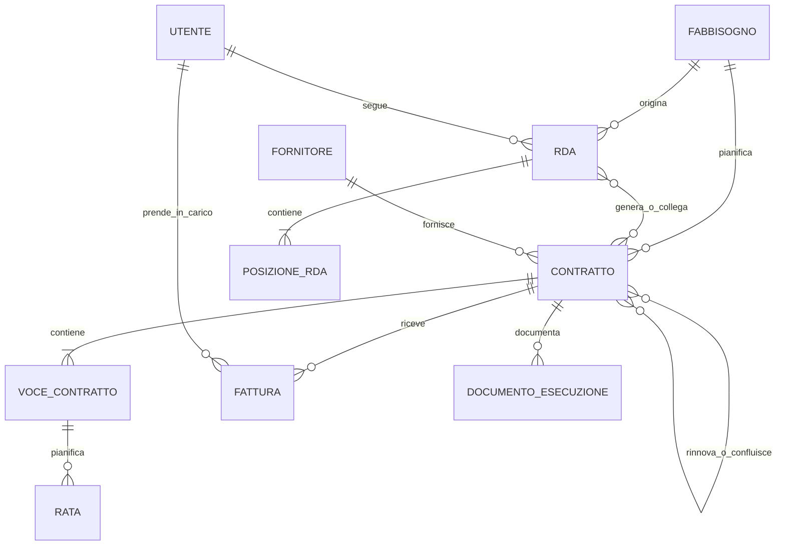

# Modello dati

## Scopo

Questa è una mappa orientativa delle principali entità del Registro contratti. La definizione normativa resta in [`docs/SPEC.md`](SPEC.md); campi, vincoli e indici effettivi sono definiti nei modelli e nelle migration Django.

## Mappa del dominio

Il diagramma è intenzionalmente concettuale: omette configurazioni, tabelle di supporto, storia e dettagli di cardinalità che cambiano con le revisioni della SPEC.

## Aree principali

### Organizzazione e accesso

- **Utente**: identità sincronizzata o autenticata tramite Active Directory.
- **Ruolo**: Admin, Editor o Reader.
- **Cluster**: perimetro organizzativo che limita lettura e scrittura.
- **Amministrazione acquisti**: capacità assegnata a utenti specifici, distinta dai ruoli AD.

### Programmazione

- **Fabbisogno**: esigenza continuativa o una tantum da pianificare.
- **Sottocluster**: sottocategoria di un cluster, assegnabile al fabbisogno; raggruppa il piano ordini. Ha un *owner* (testo, informativo). Un'assegnazione di cluster può essere limitata a un sottocluster (Rev25).
- **Budget del sottocluster**: importo assegnato a un sottocluster per anno e natura (OPEX/CAPEX), inserito dall'amministrazione; il report del budget lo mostra, con il residuo rispetto al budget di riferimento (fatturato e stanziato a competenza), quando si filtra per sottocluster (Rev23).
- **Fonte di finanziamento**: tabella di configurazione assegnabile a fabbisogno e WBS; compare sulle righe del piano ordini.
- **Fornitore**: controparte del contratto.
- **Configurazioni**: soglie, lead time, giorni di pagamento, tabelle SAP e altri parametri gestibili.

### Contratto e budget

- **Contratto**: accordo registrato, anche “senza contratto” o una tantum nei casi previsti.
- **Voce contratto**: componente economica associata a cluster, conto e WBS.
- **Piano di fatturazione e rata**: distribuzione temporale degli importi.
- **Relazioni fra contratti**: predecessore, rinnovo, proroga e confluenza.

Gli importi monetari usano `Decimal` e i valori derivati sono calcolati dal motore.

### Processo d'acquisto

- **RDA**: richiesta d'acquisto con fase, dati SAP e collegamenti alla pratica.
- **Posizione RDA**: riga economica e contabile della richiesta.
- **Evento RDA**: avanzamenti e storia del processo.
- **Fattura**: documento importato o registrato e sottoposto a presa in carico, assegnazione, convalida e trasferimento.
- **Stanziamento** (Rev21): costo di competenza non ancora fatturato, su una voce e, se c'è, sulla rata che sostituisce; conta nel budget a competenza finché non arriva la fattura. La fattura porta il proprio **periodo di competenza**.
- **Documento di esecuzione**: evidenza operativa, ad esempio DDT, MIGO, MAP o attestazione.

### Tracciabilità

Le entità di dominio rilevanti usano `django-simple-history`. Le operazioni MCP hanno inoltre un registro dedicato e attribuiscono le modifiche all'utente autenticato.

## Invarianti

- Nessuna cancellazione fisica dei dati di dominio, salvo eccezioni tecniche esplicite.
- Importi in `Decimal`, arrotondati secondo la SPEC.
- Date come `datetime.date`, con estremi inclusi.
- Valori derivati non persistiti, salvo rate modificabili previste dal modello.
- Visibilità e modifica limitate per ruolo e cluster.
- Le migration già confluite in `main` non vengono riscritte.
- Ogni variazione del modello richiede migration, test e aggiornamento della SPEC quando cambia il comportamento.

## Dove approfondire

- [SPEC](SPEC.md): modello logico e regole.
- [TEST_CASES](TEST_CASES.md): esempi numerici e invarianti verificabili.
- [ARCHITECTURE](ARCHITECTURE.md): confini fra dominio, motore, interfaccia e MCP.
